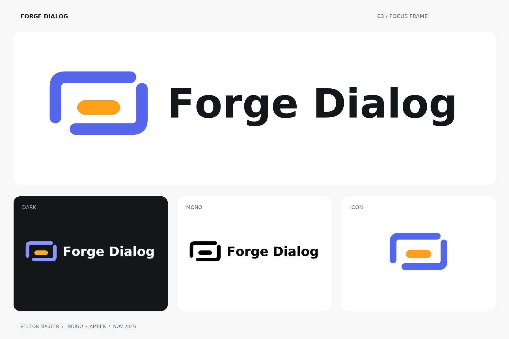

# Forge Dialog brand

**Concept 03 — Focus Frame.** Two open corners of a dialog frame around an amber primary-action
pill: a dialog, reduced to the one thing it exists to ask.

The wordmark is set in DejaVu Sans Bold and converted to outlines, so the SVGs need no font to
render. The font's licence is in [`licenses/`](licenses/DejaVu-font-license.txt).

## Files

| Path                                            | What it is                                         |
| ----------------------------------------------- | -------------------------------------------------- |
| `svg/horizontal/`                               | Mark and wordmark side by side                     |
| `svg/stacked/`                                  | Mark above the wordmark                            |
| `svg/icon/`                                     | The mark alone                                     |
| `svg/wordmark/`                                 | The name alone                                     |
| `forge-dialog-c03-icon-master.svg`              | The mark on its construction grid                  |
| `forge-dialog-c03-horizontal-editable-text.svg` | Horizontal logo with live text, for editing        |
| `brand-tokens.css`, `brand-tokens.json`         | The colours below, as CSS custom properties / JSON |

Each folder under `svg/` has five variants. Flat `color` is the default on light backgrounds and
`reverse` on dark ones; `gradient` is a softer alternative closer to the original concept art;
`black` and `white` are for single-colour use.

The web exports — favicons, touch icons, manifest, and social card — are in [`../site/`](../site/);
[`docs/website.md`](../docs/website.md#icons) lists them.

## Colours

| Token        | Light     | Dark      |
| ------------ | --------- | --------- |
| Indigo frame | `#5468e8` | `#8896ff` |
| Amber action | `#ff9f1c` | `#ffaf23` |
| Ink          | `#14171c` | —         |
| Paper        | `#f6f7f9` | —         |

## Usage

- Use the horizontal logo at 180 px wide or more, the stacked logo at 160 px or more, and the mark
  alone below that. Do not use the mark below 24 px.
- Keep clear space around the logo equal to the frame's stroke (32 units on the 320 × 256 grid).
- On dark backgrounds use `reverse` or `white`; on light ones, `color` or `black`.
- Beside the written name, the mark is decorative: give it `alt=""` (or `aria-hidden="true"` when
  inline). Where the logo replaces the name, give it `alt="Forge Dialog"`.
- Do not distort the proportions, move the amber pill, close the two gaps in the frame, or add
  shadows or other effects.
